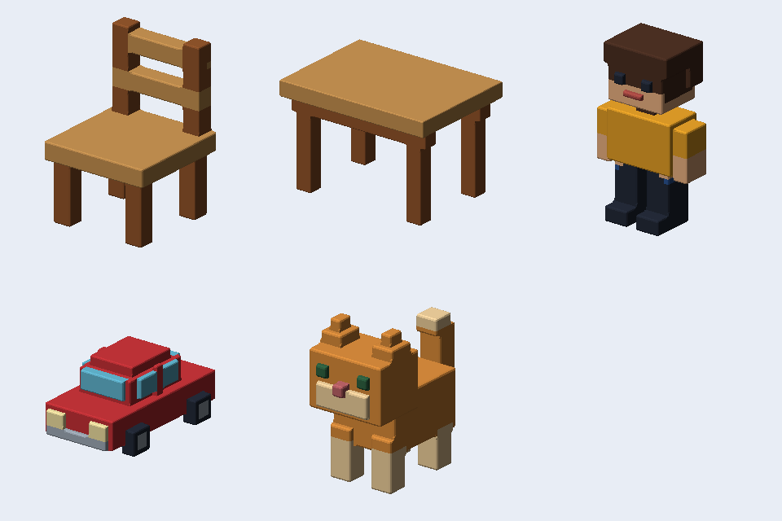

# YY3Designer のサンプル

`examples.yy3d`には、椅子・テーブル・子供・車・猫・ロンドンの時計塔の6オブジェクトを収録しています。「開く」で読み込み、オブジェクトの一覧から切り替えて編集してください。各作例は6方向のドット絵、寸法、丸み、厚みの削り情報を保存しています。脚の間などの空間も保持し、厚みを削る・戻すツールで調整できます。

| 作例 | 個別プロジェクト | 3Dプレビュー |
| --- | --- | --- |
| 椅子 | [chair.yy3d](chair.yy3d) | [chair.png](chair.png) |
| テーブル | [table.yy3d](table.yy3d) | [table.png](table.png) |
| 子供 | [child.yy3d](child.yy3d) | [child.png](child.png) |
| 車 | [car.yy3d](car.yy3d) | [car.png](car.png) |
| 猫 | [cat.yy3d](cat.yy3d) | [cat.png](cat.png) |
| ロンドンの時計塔（エリザベス・タワー） | [london-clock-tower.yy3d](london-clock-tower.yy3d) | [london-clock-tower.png](london-clock-tower.png) |

時計塔は48×176×48ドットのオリジナルのデフォルメ作例です。四面の時計は10時10分を示し、石造りの縦長の本体、尖頭窓、金色の縁取り、屋根と四隅の小塔を表現しています。6方向のドット絵を編集でき、厚みを削る・戻す操作にも対応します。石材の輪郭を保つため丸みの初期値は0です。「丸み」で見え方の変化も試せます。個別PNGは640×960の3Dプレビューです。

`robots.yy3d`をアプリで開きます。「ピクセルロボ」と「角丸ロボ」の2オブジェクトを切り替え、方向ごとのドット絵と厚み・丸みを調整できます。各オブジェクトに6方向の画像を保存しています。

`robot.png`は32×32の原画です。「写真・イラストをドット絵へ」で取り込む場合、幅32・高さ32、最近傍、減色なしを選ぶと元のドットを保持します。別の寸法や色数で縮小・減色を試すこともできます。`preview.png`は角丸ロボの3D出力例です。

作例の再生成方法は[開発者向け](../../docs/developer/yy3designer.md)に記載しています。
