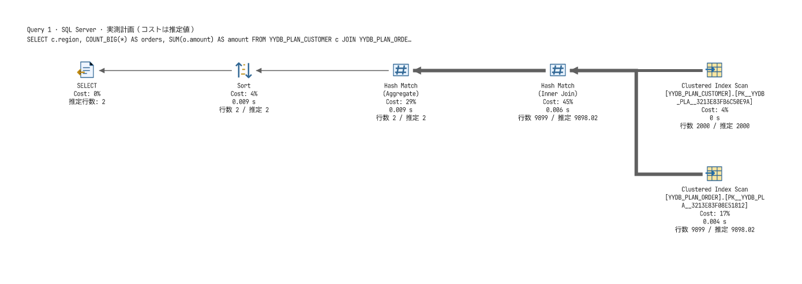
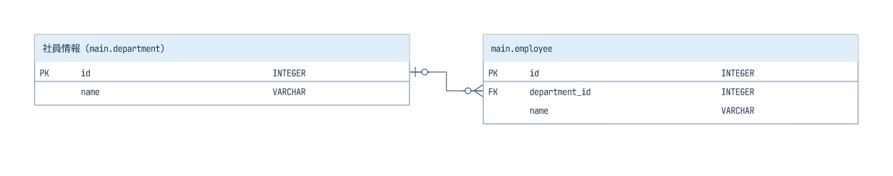

# yydbmanager 実行計画・ER図の比較検証（2026-10-21）

> 検討・作業記録です。現在の操作・内部仕様は[文書案内](../../README.md)を参照してください。

## 判定と比較方法

実行計画の初期版は、縦方向の角丸ボックス中心でSSMSの表示・操作との差が大きかった。Microsoft公式の説明と画面例を確認し、主要な表示とナビゲーションを改修した。ER図は追加実装により7DBのリバース・列別表示・基本的な多重度・配置編集・論理名・表示水準・意味モデル保存まで進めた。SSMS／A5と完全に同等という判定ではなく、未対応部分を以下に記録する。

比較対象はMicrosoft LearnとA5作者の公式ヘルプ・解説に記載された機能。最新版のSSMS／A5実行ファイルを並べた操作比較やピクセル単位の一致検査は行っていない。A5オンラインヘルプの版と現行製品の版には差があり得るため、現行製品の全機能を網羅した判定ではない。

SQL Server以外の追加改善・実接続結果は[DB別の実行計画検証](yydbmanager-cross-database-plans-2026-10-21.md)に記録した。

## SSMSを基準に実施した変更

| 対象 | yydbmanagerの現在の状態 |
|---|---|
| 演算子と流れ | 白背景、演算子別の自作ベクターアイコン、左に結果・右に入力、右から左へ流れる線に変更。Scan／Seek、結合、集約、Sort等を区別 |
| テキスト | アイコン下に物理／論理演算、対象名、推定コスト比率、取得済みの実測時間・行数。選択したラベルは青地・白文字 |
| 複数文 | 文ごとの見出しと独立したツリー。コスト比率の分母も文ごとに分離 |
| 推定と実測 | 未取得の実測値をゼロに置換しない。SQL Serverの推定繰返し回数を考慮し、全実行の推定行数と実測行数を比較。スレッド別値も保持 |
| 時間とコスト | コストは推定指標。実測経過時間はスレッド最大値を表示し、並列スレッドの時間を加算して経過時間にしない |
| 線 | 行数によって太さを変え、クリック／ホバーでデータフローの指標を表示。太さは独自の対数尺度でありSSMSの厳密な計算式の再現ではない |
| 詳細 | ホバーツールチップ、2列のプロパティ一覧、値の全文表示。警告の種類・属性、並列属性、述語・出力列・実測カウンター等を保持 |
| 移動と倍率 | Ctrl＋ホイール、倍率指定、拡大／縮小／100%／全体表示、空白ドラッグ、縦横スクロールバー、右下＋のミニマップ |
| 検索と保存 | 演算子・対象・プロパティの検索、原文表示、`.sqlplan`原文保存、`.yyplan`モデル保存、起動引数からのオフライン読込 |

基準資料：Microsoftの[推定計画の表示](https://learn.microsoft.com/en-us/sql/relational-databases/performance/display-the-estimated-execution-plan?view=sql-server-ver17)、[実測計画の表示](https://learn.microsoft.com/en-us/sql/relational-databases/performance/display-an-actual-execution-plan?view=sql-server-ver17)、[演算子リファレンス](https://learn.microsoft.com/en-us/sql/relational-databases/showplan-logical-and-physical-operators-reference?view=sql-server-ver17)。推定取得ではSQLを実行せず、実測取得では実行する区別を維持している。

アイコンは独自に描画し、MSの画像を製品へ転用していない。フォントは既存yyシリーズのUDEV Gothicを使用する。全演算子固有の絵柄、長い名前の完全表示、SQL選択との連動、ライブ統計は残る。[計画比較](https://learn.microsoft.com/en-us/sql/relational-databases/performance/compare-execution-plans?view=sql-server-ver17)と[自動分析](https://learn.microsoft.com/en-us/sql/relational-databases/performance/analyze-an-actual-execution-plan?view=sql-server-ver17)も未実装であり、警告の表示を自動チューニング機能と呼ばない。

改修後の実測計画（yydbmanager自身が出力した画像）：



## A5:SQL Mk-2のER図との比較

| 観点 | yydbmanager | 判定 |
|---|---|---|
| DBからのリバース | 7DBのカタログ範囲内の表・ビューを取得 | 実装 |
| 主キー・外部キー | 7DBで複合PK／FK／UNIQUEとNULL許可を取得。外部5DBはDocker実接続済み | 実装 |
| 表の選択 | 生成後に一覧から表示対象を複数選択。取得自体は全体、500件上限 | 一部 |
| 表カード | 名前欄・型欄の位置揃え、PK区画、PK／UQ／FK表示、NOT NULLを表示 | 実装 |
| 関連線 | 構成列の先頭へ接続し、複合キーは制約ごとに1本。NULL許可と一意性に基づく基本的なIE多重度。IDEF1X切替はなし | 一部 |
| 名前と表示水準 | 表／列の論理名編集、物理名／論理名／両方、表名／主キー／列／型の切替 | 実装 |
| 属性編集 | 表と列の物理名／論理名、型、NULL許可、既定値、主キー／一意キー、列索引を追加・編集・削除 | 実装 |
| 配置とモデル | 表のドラッグ、関連線追従、高さを考慮する整列、パン・ズーム、`.yyer`へ意味モデル・配置・表示対象を保存し再読込 | 実装 |
| 設計支援 | リレーション追加・編集・削除、複合列対応、7DB方言のDDL生成、32操作のUndo／Redo。ページ・用紙設定はなし | 一部 |
| 出力 | SVG／yydraw保存あり | 一部 |

比較の根拠はA5公式の[リバース生成](https://a5m2.mmatsubara.com/help/ER/ERReverse.html)、[エンティティ属性](https://a5m2.mmatsubara.com/help/ER/ERPropertyEntity.html)、[表示水準・ページ設定](https://a5m2.mmatsubara.com/help/ER/ERPropertyPage.html)、[ER図の記法・編集・DDL生成の説明](https://a5m2.mmatsubara.com/tips/er_draw/)である。

検証中に見つかったSQLite複合外部キーの誤表示は修正した。列ごとに重複して線を作らず、制約ごとに1本にまとめる。参照先の大文字小文字が異なる場合も接続し、参照列省略時は主キーの順序から列名を解決する。これはA5相当のER設計機能を追加したという意味ではない。

追加実装では、上記のうちキー取得・表カード・多重度・配置・意味モデル・論理名・表示水準を進めた。自己参照と同じ列にある表の関連線は右側へ回し、複合キーの列順・省略された参照列・SQLiteの識別子の大文字小文字も検査する。関連先が権限外・表示対象外なら線を表示しない。複合FKの全列対応はプロパティに残す。

残る差は、型修飾・既定値・生成列・CHECK・既存索引の完全な逆取得、コメントからの論理名取得、用紙・印刷、障害物を避ける配線、削除規則や遅延制約等。型表示はカタログの型名を使い、外部DBでは桁数等の完全な型定義をまだ復元していない。DDLはモデルの設計内容を出力する機能であり、元DBの完全な複製用とはしない。yydrawへの出力は汎用の図であり、ERとして再編集する保存形式は`.yyer`である。

## ER設計編集・DDLの追加検証

表・列の追加／編集／削除、主キー／一意キー、索引、リレーション、既定値、列順の編集を追加した。提案モデルの整合性を検証してから適用するため、失敗時に元のモデルを保持する。表名／列名の変更はキー・索引・参照定義へ追従する。依存列や参照先キーの削除は拒否する。列の型と既定値の入力はSQL断片として引用符・括弧を検査し、文区切りや他の列定義を混入できないようにする。

生成SQLはSQLタブへ出力し、自動実行しない。同梱2DBでは生成DDLを実行し、既定値、索引、外部キーの制約違反を検証した。外部5DBでも実行して同じ項目を確認した。[DDL適用の実接続結果](../../../apps/yydbmanager/tests/docker/results/2026-10-21-design.json)を参照。検証対象は整数・VARCHARとPK／UNIQUE／複合FK・単純列索引であり、全ての型・DB拡張のDDLを検証したものではない。

SQLiteは表内FK、DuckDBは親表の先行作成、外部5DBは表作成後のALTER TABLEを使用する。DuckDBの自己参照・循環は生成時にエラーとする。非表示の依存表も含め、モデル外の参照先はエラーにする。ビューは元のSELECT定義を保持しないためSQLを出力せず注記する。[SQLiteの仕様](https://www.sqlite.org/lang_createtable.html)、[DuckDBの仕様](https://duckdb.org/docs/current/sql/statements/create_table)、[PostgreSQLの仕様](https://www.postgresql.org/docs/17/sql-createtable.html)を参照した。

ファイルは形式2へ更新し、既定値・索引を保存して再読込する試験と、従来の形式1の移行試験を追加した。以前のアプリによる新定義の黙った消失を避けるため、形式2は旧実装で開けない。編集・表示変更・配置は最大32操作のUndo／Redoを備える。画面試験は列・索引の実ダイアログ、DDLタブの追加、DDL生成時に実行が始まらないこと、Undo／Redoの一致を含む。

[設計編集後にDDLを生成した画面](images/yydbmanager-er-design-2026-10-21.png)。リリース版で新規表・列・索引の作成ダイアログとDDLタブ生成、最大化／復元を確認した。

## ERの追加実装と性能検証

SQLite／DuckDBの単体試験、PostgreSQL 17.11・MySQL 8.4.11・SQL Server 16.0.4305.5・Oracle 23.26.3・Db2 12.1.5のLinux ODBC実接続で複合PK・FK・UNIQUE・NOT NULLを検証した。[5DBの結果](../../../apps/yydbmanager/tests/docker/results/2026-10-21-er.json)に記録した。Windowsでは表選択・論理名編集の実ダイアログ、選択・ドラッグ・線の追従、表示切替、保存と再読込、最大化・復元を検査する。

描画は図全体の再解析から、画面内の表だけを描く方式へ変更した。表SVGの解析結果と倍率・端数座標ごとの画像を再利用し、画像キャッシュは64MiB、単体は16MiBに制限する。大きい表はベクターで描画する。多重度記号は8種類を共有する。SVG／PNG出力は従来の全体出力経路を維持する。

測定条件はこのWindows x64環境のreleaseビルド、500表（各8列）・2,000関連、1,400×800ピクセル、100%、初回の後20回の表移動。通信・GDI転送・入力待ち時間は含めない。最適化前の再描画p95は609.75ms、座標更新5.36msだった。最終測定値は同フォルダーの`yydbmanager-er-performance.json`に記録する。実際の全UIフレーム時間や全体表示まで60fpsを保証した測定ではない。



## 検証データと再現方法

専用DockerのSQL Server 2022 CU27-GDR（16.0.4305.5）、WindowsのODBC Driver 17を使用。顧客2,000件・注文10,000件から、Hash結合＋集約＋Sortと、Index Seek＋Nested Loopsの実測Showplan XMLを取得した。通常の接続・精度・入出力・計画試験も同じ接続で実行した。データと接続は検証用であり、既存のユーザーDBは使用していない。

`apps/yydbmanager/tests/fixtures/sqlserver-hash-sort.sqlplan`はこの実測出力。CIでは外部DBなしで解析とUIの回帰を検証できる。生成元SQLと取得は`crates/yy-db-core/tests/docker_live.rs`の`YYDB_COMPLEX_PLANS`分岐を参照。

```powershell
cargo test --manifest-path apps/yydbmanager/Cargo.toml --workspace --locked
cargo clippy --manifest-path apps/yydbmanager/Cargo.toml --workspace --all-targets --locked -- -D warnings
$env:YYDBMANAGER_PLAN_FIXTURE=(Resolve-Path apps/yydbmanager/tests/fixtures/sqlserver-hash-sort.sqlplan).Path
# 非表示プロセスとして起動し、終了コードを確認する
Start-Process apps/yydbmanager/target/release/yydbmanager.exe -ArgumentList '--ui-smoke-test','target/yydbmanager-ssms-ui' -WindowStyle Hidden -Wait
./apps/yydbmanager/tests/windows-shell.ps1 -Executable apps/yydbmanager/target/release/yydbmanager.exe -PlanFile $env:YYDBMANAGER_PLAN_FIXTURE -OutputDirectory target/yydbmanager-ssms-shell
```

単体試験は文ごとのコスト、繰返し行数、並列カウンター、欠測値、警告属性、不正な親参照・循環、複合FKを検査する。GUI試験は接続、結果、ER、ツリー展開、3サイズ、計画のズーム・選択・プロパティ・ツールチップ・パン・ミニマップ・検索に加え、最大化／復元と接続保存ダイアログを検査する。画面画像を目視し、黒い未描画領域と旧配置の残像がないことを確認する。ERのDB検証と描画性能の測定範囲は上記追加実装の節に示す。

最終結果：coreの22テスト・UIの1テスト、共通図描画の42テスト、fmt、Clippy（全ターゲット、警告エラー化）、releaseビルド、同梱2DBのオフライン試験、通常／複合計画のネイティブUI試験、ERダイアログ・シェル・最大化／復元試験が成功。SQL Server実接続の[結果JSON](../../../apps/yydbmanager/tests/docker/results/2026-10-21-sqlserver-plan.json)と外部5DBのER検証結果を保存した。GitHub上のCI実行結果ではなく、ローカルでの検証結果である。

最終性能測定は初回配置46.60ms、初回描画35.67ms、座標更新p95 0.30ms、移動後の描画p95 7.57ms。最適化前の描画p95 609.75msから約80倍に短縮した。上記の描画試験条件に限る結果であり、他の画面倍率・表の列数・全体表示では所要時間が変わる。

設計編集追加後の再測定は、配置66.30ms、初回描画35.10ms、座標更新p95 0.23ms、描画p95 7.53ms。[測定JSON](yydbmanager-er-design-performance.json)を保存した。測定条件は前記と同じ。
