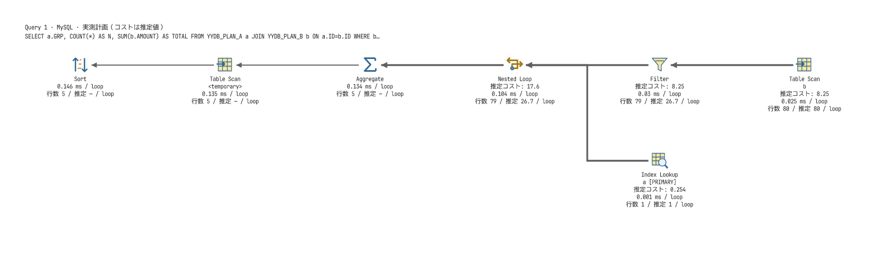
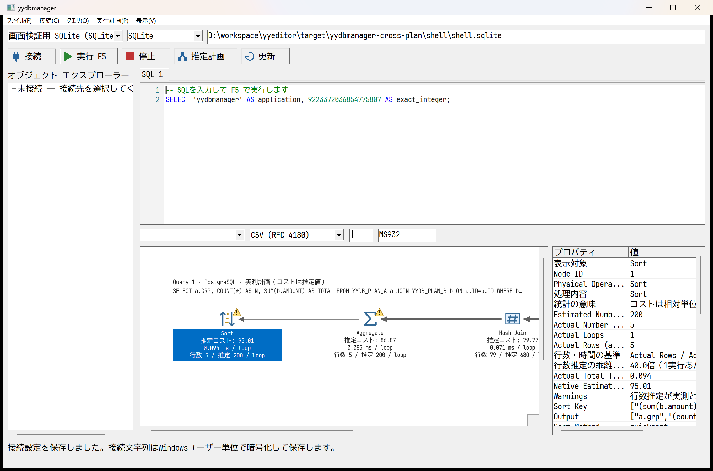

# yydbmanager：DB別の実行計画表示検証（2026-10-21）

追記：Oracle／Db2の実測取得を追加した。[最新の対応・権限・検証結果](yydbmanager-oracle-db2-actual-2026-10-21.md)を参照。以下はその前段の記録。

SSMSを基準とした白背景・演算子アイコン・左向きフロー・行数に応じた線幅・選択・プロパティ・ツールチップ・ズーム・パン・ミニマップを7DBで共用する。今回、SQL Server以外の計画解釈と統計表示を追加した。製品全機能や全演算子の完全な同等性を保証する判定ではない。

## 変更と取得範囲

| DB | 表示・解析の改善 | 実測取得 |
|---|---|---|
| PostgreSQL | VERBOSEでスキーマ・索引・出力列・条件・Sort/Groupキーを保持。BUFFERS、ループ平均時間、全実行行数、並列属性、ディスクSort・複数Hashバッチを表示 | 対応 |
| MySQL 8 | JSON v1の結合順を左深木へ展開し、Sort・集約・実体化・重複除去・Unionを明示。JSON v2のinputs木にも対応。TREE実測計画からループ平均時間・行数・繰返し回数・未実行ノード・対象表／索引を取得 | 新規対応、8.4.11で検証 |
| Oracle | TABLE ACCESS/ROWID/GROUP BYなどを共通アイコンへ対応。アクセス／フィルター条件、推定bytes・秒・パーティション範囲・分配方法・オブジェクト種別を保持 | 未対応、推定計画のみ |
| IBM Db2 | TBSCAN・IXSCAN・NLJOIN・HSJOIN・MSJOIN・GRPBY等を説明的な演算名とアイコンで表示。述語と適用方法、累積timeron、I/O、CPUを保持 | 未対応、推定計画のみ |
| DuckDB | extra_infoの表・条件・推定行数を抽出。演算子時間を秒からmsへ変換し、集約をHash Joinと区別 | 対応、同梱1.4.1で検証 |
| SQLite | SCAN・SEARCH・一時B-treeを区別し、対象名と元の詳細を保持 | DBのQUERY PLANはコスト・行数・ノード時間を提供しない |
| SQL Server | 従来のShowplan XML、推定コスト比率、スレッド統計、警告表示を維持 | 回帰確認済み |

元の演算名と属性は保存・プロパティに残す。各文の見出しにSQLを表示する。推定行数と実測行数の差が10倍以上の場合は、yydbmanagerの比較による警告を表示する（両方が正数で、未実行を除く）。DB自身が返したディスク退避の警告とは説明文で区別する。ゼロ値は未取得の代用にしない。

## 数値の扱いと公式資料

- PostgreSQLのコストは子を含む相対値。Actual RowsとActual Total Timeは1ループ平均であり、行数×loopsをフローの全実行行数に使う。カードの推定／実測比較は1実行あたりに揃える。時間×loopsや子の時間の合計を壁時計時間として表示しない。[公式Using EXPLAIN](https://www.postgresql.org/docs/current/using-explain.html)
- MySQLのJSON v1のprefix_costとread/eval costは同じ範囲の指標ではない。TREEの時間は子を含むループ平均ms。新旧JSONとTREEを別々に解析する。[公式EXPLAIN](https://dev.mysql.com/doc/refman/8.4/en/explain.html)、[公式出力形式](https://dev.mysql.com/doc/refman/8.4/en/explain-output.html)
- DuckDBのoperator_timingとクエリ全体のlatencyを区別し、並列演算子の合計をクエリ時間に置き換えない。[公式Metrics](https://duckdb.org/docs/current/dev/metrics)
- OracleのTIMEは推定秒、COSTはオプティマイザーの推定値。[公式実行計画の説明](https://docs.oracle.com/en/database/oracle/oracle-database/19/tgsql/generating-and-displaying-execution-plans.html)、[Oracle SQL Tuning Guide](https://docs.oracle.com/cd/F82042_01/tgsql/sql-tuning-guide.pdf)
- Db2のTOTAL_COSTは累積timeron、IO_COSTはページI/O、CPU_COSTは命令数。[公式EXPLAIN_OPERATOR](https://www.ibm.com/docs/SSEPGG_11.1.0/com.ibm.db2.luw.sql.ref.doc/doc/r0001101.html)、[公式EXPLAIN_PREDICATE](https://www.ibm.com/docs/en/ias?topic=tables-explain-predicate)
- SQLiteの一時B-treeはORDER BY/GROUP BY/DISTINCTなどの処理を示す。[公式EXPLAIN QUERY PLAN](https://www.sqlite.org/eqp.html)

SQL Server以外には一律の推定演算子コスト比率を作らない。累積コストの単純な子との差分では、再実行・並列・結合順の影響を誤解しやすいため、DB固有の数値と単位を表示する。

## 検証

- 単体テスト30件（core 29、Windows接続設定1）、fmt、Clippy警告なし、Windows releaseビルド。
- 同梱SQLite・DuckDBで結合＋集約＋Sortの推定／取得可能な実測計画を生成。
- 専用DockerのPostgreSQL 17.11、MySQL 8.4.11、SQL Server 16.0.4305.5、Oracle 23.26.3、Db2 12.1.5で実接続。各80件の2表を結合・集約・Sortし、推定計画と対応DBの実測計画を取得・描画。MySQLは同一セッションでJSON v2も確認し、設定を戻した。[結果JSON](../../apps/yydbmanager/tests/docker/results/2026-10-21-cross-plans.json)
- 6DBの実取得モデルを`apps/yydbmanager/tests/fixtures/*-complex.yyplan`へ保存し、外部DBなしで解析・描画回帰を検証する。DB2述語とOracle TIME属性も確認する。
- Windows実行ファイルで7DBの保存計画を開き、ズーム・全体表示・選択・プロパティ・ツールチップ・パン・ミニマップ・検索のUI試験。PostgreSQL計画を開いた状態で最大化・復元、接続ダイアログと保存再読込も確認。
- 専用CIへ6DBの保存計画UI試験を追加。手動の外部DBジョブでは複合計画を必須化した。

## 残る差

Oracle／Db2の実測取得、計画比較、SQL位置との選択連動、全演算子の専用アイコンは未対応。Db2の共有サブツリーは代表親へつなぐ木表示であり、DAGの複数出力をすべて描くものではない。SQLiteのQUERY PLAN出力はバージョンで変わり得るため、元の詳細も確認する。MySQL 8未満や未検証バージョンの実測取得を保証しない。
