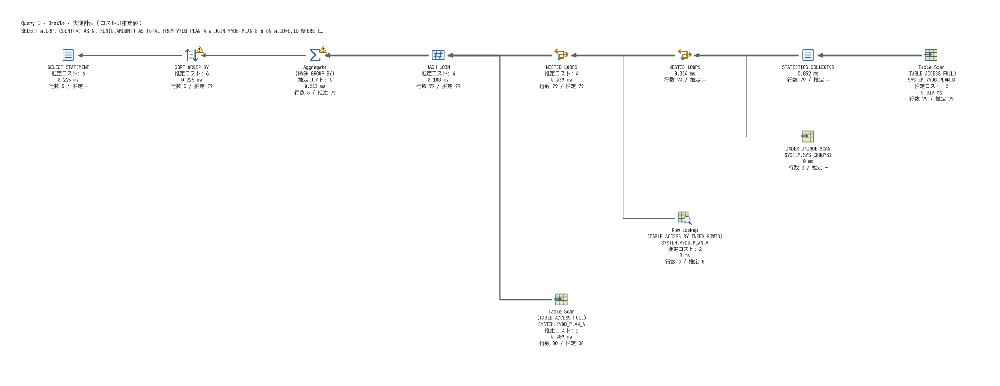
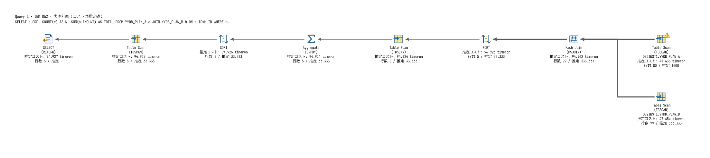

# Oracle・Db2実測計画の追加（2026-10-21）

従来未対応だったOracleとDb2の実測取得を追加した。共通のSSMS形式ビュー・保存・画像出力・プロパティ・ツールチップで表示できる。SQLiteのEXPLAIN QUERY PLANの取得範囲は従来どおり。

| DB | 実測表示 | 準備 |
|---|---|---|
| Oracle | 最後の実行の行数・starts・経過時間、バッファ取得、ディスクI/O、メモリ、ディスク退避 | ALTER SESSIONとV_$PARAMETER・V_$SESSION・V_$SQL_PLAN_STATISTICS_ALLの参照権限 |
| Db2 | section actualsのCARDINALITY、パーティションごとの値、述語 | EXPLAIN表と稼働中のYYDBMANAGER_ACTIVITYモニター、WLM_GET_CONN_ENV/WLM_SET_CONN_ENV/EXPLAIN_FROM_ACTIVITY等の実行・表参照権限 |

## Oracle

同一接続のstatistics_levelを読み、ALLへ変更してSQLを一度実行する。V$SESSIONのPREV_SQL_ID・PREV_CHILD_NUMBERで直前の実行カーソルを取得し、V$SQL_PLAN_STATISTICS_ALLのLAST_*を読む。最後に元のstatistics_levelへ復元する。SQL失敗・取消・統計取得失敗でも復元を試み、復元失敗は元のエラーとともに通知する。

LAST_ELAPSED_TIMEはマイクロ秒からmsへ変換する。子の処理を含む値で、演算子の値を合算してクエリ時間としない。LAST_OUTPUT_ROWSは全startsの合計として保持する。推定行数はCARDINALITY×LAST_STARTSで全開始回数の範囲へ揃え、推定誤差の比較では1開始あたりに戻す。

Oracle ODBCは通常のコメントを除去するため、カーソルを分離する識別子をヒントコメントへ付ける。既存のヒントコメントがあれば末尾へ追加し、既存ヒントの前へ置かない。識別子はOracleに認識されないため無視される。実行ごとにSQL_IDが異なること、対象表が正しいことを実機で検証した。実測用のカーソルは元SQLのキャッシュ・SQL_IDに依存する管理機能と同一ではない。

根拠：[Oracle V$SQL_PLAN_STATISTICS_ALL](https://docs.oracle.com/en/database/oracle/oracle-database/26/refrn/V-SQL_PLAN_STATISTICS_ALL.html)、[STATISTICS_LEVEL](https://docs.oracle.com/en/database/oracle/oracle-database/12.2/refrn/STATISTICS_LEVEL.html)、[ヒントの扱い](https://docs.oracle.com/en/database/oracle/oracle-database/18/tgsql/influencing-the-optimizer.html)。AWR・SQL Monitorのレポートは使用しない。

## Db2

「実行計画 → Db2実測収集の準備SQL」で必要なDDLを新しいSQLタブに開く。DBへは自動送信しない。管理者が既存オブジェクトと運用方針を確認して必要な文を選択する。

```sql
-- EXPLAIN表がない場合のみ
CALL SYSPROC.SYSINSTALLOBJECTS('EXPLAIN','C',CAST(NULL AS VARCHAR(128)),CURRENT SCHEMA);
-- モニターがない場合のみ
CREATE EVENT MONITOR YYDBMANAGER_ACTIVITY FOR ACTIVITIES WRITE TO TABLE MANUALSTART;
SET EVENT MONITOR YYDBMANAGER_ACTIVITY STATE 1;
```

アプリはモニターを自動作成・起動せず、対象の存在・稼働・参照権限をSQL実行前に確認する。既存ワークロードのactivity収集もこのモニターへ記録され得るため、作成・起動はDB管理者の作業とする。

WLM_GET_CONN_ENVで設定を保存し、現在の接続だけWITH DETAILS, SECTION／ALLパーティション／BASEを有効化する。SQLを一度実行して元の設定へ復元し、モニターをflushする。記録の反映は取消可能な最大10秒の待機で確認する。自分のAPPL_IDと実行固有コメントでUOW_ID・ACTIVITY_IDを識別する。

EXPLAIN_FROM_ACTIVITYの入出力をODBCでバインドし、返されたrequester・time・source name/schema/versionのキーでEXPLAIN表を読む。時刻の「最新」や同じSQLの推定計画で代替しない。CARDINALITYは演算子・パーティションの実測値を合算し、NULLを0に置換しない。既存の述語表示も保持する。

DB全体のSECTION_ACTUALS設定は変更しない。既存モニターや記録を削除しない。演算子別の実測時間はこのBASE収集から提供されないため表示せず、timeronやCPU命令数を時間へ変換しない。列編成表などsection actualsが取得できない計画では、その旨をエラーで示す。

根拠：[WLM_GET_CONN_ENV](https://www.ibm.com/docs/en/db2/11.5.x?topic=wmr-wlm-get-conn-env-get-settings-activity-data-collection-connection)、[WLM_SET_CONN_ENV](https://www.ibm.com/docs/en/ias?topic=wmr-wlm-set-conn-env-enable-collection-activity-data-measurement-section-actuals)、[EXPLAIN_FROM_ACTIVITY](https://www.ibm.com/docs/SS6NHC/com.ibm.swg.im.dashdb.sql.rtn.doc/doc/r0056203.html)、[EXPLAIN_ACTUALS](https://www.ibm.com/docs/en/db2/11.1?topic=tables-explain-actuals)。

## 検証

- 専用DockerのOracle 23.26.3とDb2 12.1.5で単純アクセスと結合・集約・Sortの実測取得を確認。
- 両DBで通常終了、不正SQL、実行前取消、DMLの後に収集設定が元へ戻ることを比較。UPDATEによるカウンターが1だけ増えることを確認し、統計取得失敗時も対象SQLを自動再実行しない。
- Oracleの同一SQLを2回実測して異なるSQL_IDを確認。
- Unicode ODBC呼出を明示し、Oracle単独接続でも日本語が往復するよう改善。PostgreSQL・MySQL・SQL Serverを含む外部5DBで精度・日本語・CSV/Parquet・計画・ER・DDLを回帰検証。[結果JSON](../../apps/yydbmanager/tests/docker/results/2026-10-21-actuals.json)
- 実取得したOracle／Db2の保存計画を既存のcomplex.yyplanフィクスチャへ更新。Windowsで図・プロパティ・ズーム等を検証し、準備SQLが新規タブへ開くことも確認。
- 単体テスト32件（core 31、接続設定1）、fmt、Clippy警告なし、Windows releaseビルド。




